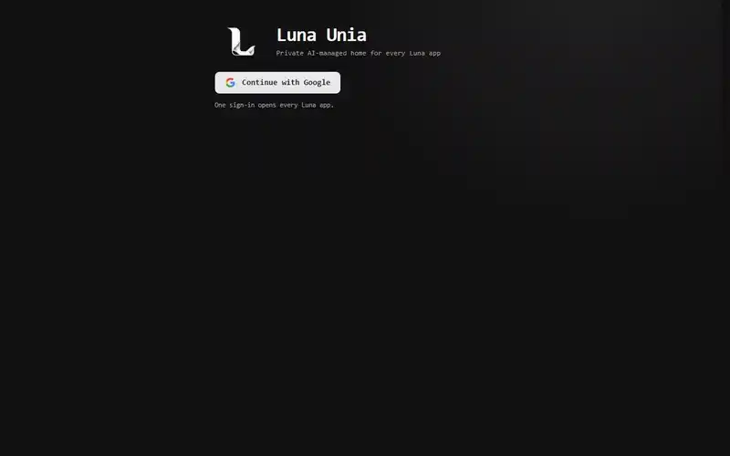
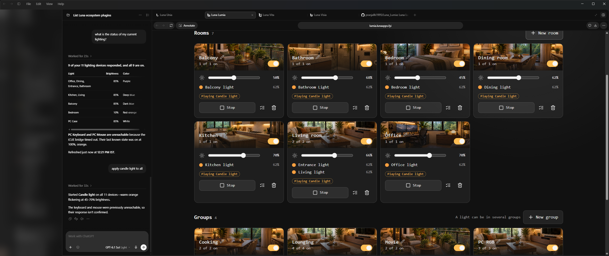

# Luna Lumia


**Control your smart lights and your PC's RGB by chatting with your AI assistant.** Lumia runs WiZ bulbs over your
local network, and keyboards, mice and case lights through OpenRGB and Corsair iCUE. Rooms, schemes, schedules, the
weather and your music can all drive them.

<p align="center">
  <a href="docs/assets/luna-lumia-showcase.mp4"></a>
</p>

<p align="center"><em>Controlling lights on the page, then an assistant setting a scheme. Select it for the sharper
video.</em></p>

## What it does

- **Home:** what is on, what is playing, the next schedule, and weather and music automation at a glance. Every room
  is a tile that glows in its lights' colors; select rooms, groups or lights and change them together from one panel.
  On a phone the tabs sit along the bottom and the panel is a sheet you pull up.
- **Lights:** finds WiZ bulbs on your network and sets power, brightness, color or white (2200–6500 K), for one
  light, a room, a group or everything. **Find moved lights** follows them after a router restart.
- **Devices:** add, rename and remove lights, rooms and groups, each with a picture; add your own with **Add image**.
- **Schemes:** solid colors or animated sequences (Candle light, Fireplace, Sunrise, ...) with fades you choose.
- **Schedules and alarms** at fixed times or relative to sunrise and sunset.
- **Weather:** your assistant looks up the forecast, and the lights take on the sky outside.
- **Music:** the lights follow the mood of what Luna Vibia plays, and can pulse on the beat.
- **PC tab:** paint a keyboard key by key and case lights LED by LED, then save the pattern as a scheme; your
  assistant can design animated per-key patterns too.

<p align="center">
  
</p>

## Quickstart

Lumia runs on [Luna Sentia](https://github.com/pranjallk1995/Luna_Sentia), which provides its database and sign-in.
On one machine you need no `.env`:

```sh
git clone https://github.com/pranjallk1995/Luna_Sentia.git
git clone https://github.com/pranjallk1995/Luna_Lumia.git
./Luna_Sentia/luna.sh start lumia
```

Open <http://localhost:18502>, sign in as Sentia's owner, and add your bulbs from the Devices tab, which scans your
network for them. Before giving Lumia a public address, set your own secrets: see
[Getting started](https://github.com/pranjallk1995/Luna_Lumia/wiki/Getting-Started). For PC lights, set up OpenRGB
or iCUE as in [PC RGB lights](https://github.com/pranjallk1995/Luna_Lumia/wiki/PC-RGB-Lights).

## Connect your AI assistant

Add `https://<your lumia MCP host>/mcp` to Claude, ChatGPT or any MCP client as a custom connector (OAuth). Then ask
for "candle light in the bedroom" or "wake me with a sunrise at 7". Every tool is listed in
[MCP tools](https://github.com/pranjallk1995/Luna_Lumia/wiki/MCP-Tools).

## Works with

- **[Luna Vibia](https://github.com/pranjallk1995/Luna_Vibia)**: the lights follow the mood and beats of what it plays.
- **[Luna Visia](https://github.com/pranjallk1995/Luna_Visia)** stores the room and light pictures.

## Documentation

The [wiki](https://github.com/pranjallk1995/Luna_Lumia/wiki) has the full reference:

| Page | What's in it |
| --- | --- |
| [Home](https://github.com/pranjallk1995/Luna_Lumia/wiki) | Every feature in detail: weather, music, beat pulses, the PC tab |
| [Getting started](https://github.com/pranjallk1995/Luna_Lumia/wiki/Getting-Started) | Setup, `.env`, sign-in |
| [PC RGB lights](https://github.com/pranjallk1995/Luna_Lumia/wiki/PC-RGB-Lights) | OpenRGB, the iCUE bridge, zones and LED ranges, troubleshooting |
| [MCP tools](https://github.com/pranjallk1995/Luna_Lumia/wiki/MCP-Tools) | Every tool your assistant can call |
| [Architecture](https://github.com/pranjallk1995/Luna_Lumia/wiki/Architecture) | Services, users, data model and database diagram |
| [Development](https://github.com/pranjallk1995/Luna_Lumia/wiki/Development) | Project structure, modules, tests |
| [Operations](https://github.com/pranjallk1995/Luna_Lumia/wiki/Operations) | The database UI |

The UI follows [UI_STYLE_GUIDE.md](UI_STYLE_GUIDE.md).

## Releases and development

Releases are on the [Releases page](https://github.com/pranjallk1995/Luna_Lumia/releases). To update: `git pull`, then
`./Luna_Sentia/luna.sh start lumia`. To run your local code and reload it as you edit:
`./Luna_Sentia/luna.sh start --build --watch lumia`.
