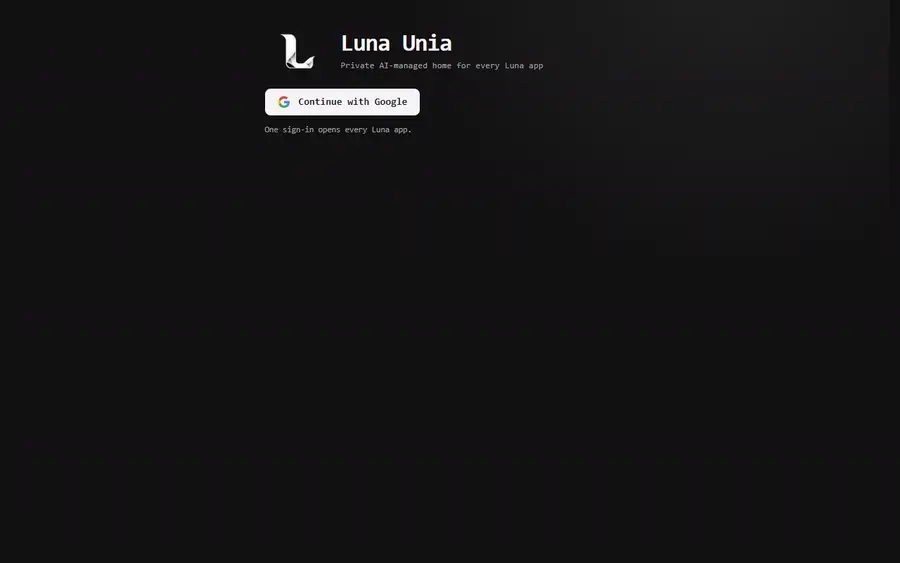
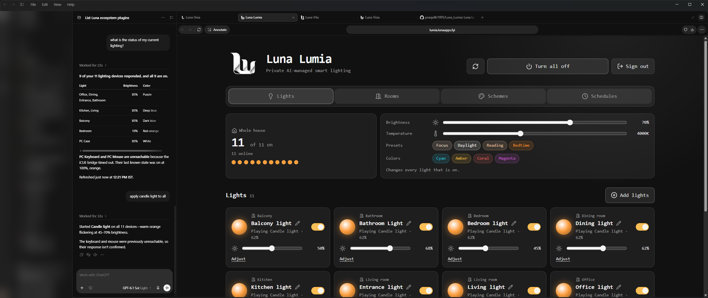
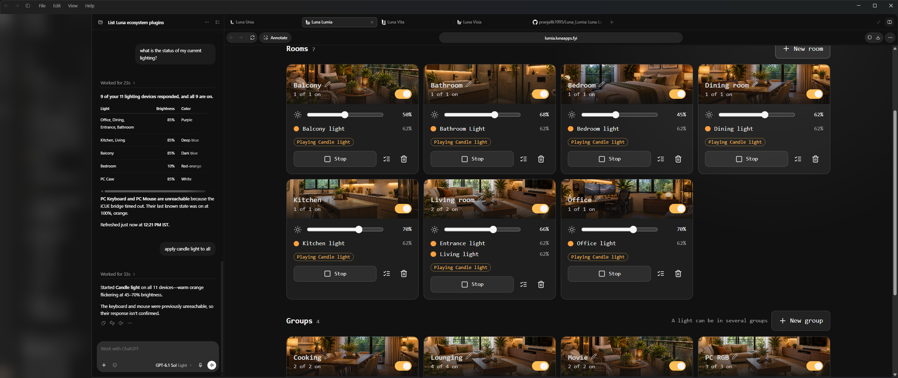

# Luna Lumia


<p align="center">
  <a href="docs/assets/luna-lumia-showcase.mp4"></a>
</p>

<p align="center"><em>From Google sign-in through Luna Unia to controlling lights in Luna Lumia, then setting a scheme from a chat assistant through its MCP tools. Select it for the sharper video.</em></p>

## Control, Automate, and Manage your Smart Lights using LLMs

> Luna Lumia is a local-first and desktop-first smart-light controller.

Luna Lumia combines React, FastMCP, PostgreSQL (in Luna Sentia), and direct local WiZ control. It runs beside [Luna Visia](https://github.com/pranjallk1995/Luna_Visia) and [Luna Vita](https://github.com/pranjallk1995/Luna_Vita) on the shared private Docker network created by [Luna Sentia](https://github.com/pranjallk1995/Luna_Sentia) while keeping its services, ports, and database separate.

> **Requires Luna Sentia, running and healthy:** Luna Lumia keeps its data in Luna Sentia's PostgreSQL (`luna-sentia-db`) and joins Sentia's `luna_sentia_network`; it has no database of its own. Start [Luna Sentia](https://github.com/pranjallk1995/Luna_Sentia) first and wait until its `postgres` and `ollama` services report healthy, as described under [Start](#start).

<p align="center">
  
  
</p>

Lumia discovers compatible bulbs, stores their IP and normalized MAC addresses, and controls power, brightness, RGB color, and white temperature. Rooms, groups, schemes, transitions, schedules, and alarms persist in PostgreSQL and are available to MCP clients. The initial `Living room light` is seeded at `192.168.1.8`.

## Current features

### Lights and network discovery

- Discover WiZ bulbs without adding them automatically.
- Persist IP and normalized MAC addresses so known bulbs can be reconciled after DHCP changes.
- Rename, delete, and refresh lights on demand.
- Control one light, a room/group, or all lights.
- Set power, brightness, RGB color, or white temperature from 2200-6500 K.
- Apply UI changes immediately. Lumia does not continuously poll bulbs in the background.
- Drive PC RGB devices through [OpenRGB](https://openrgb.org) (such as motherboards) or
  Corsair iCUE (keyboards and mice): each device becomes a light that shows one color, so
  schemes, schedules, weather and music work on it too.

### Rooms, groups, and images

- Put each light in at most one room and in multiple reusable groups.
- Add or remove memberships without deleting lights.
- Rename rooms and groups with validated names up to 30 characters.
- Display Luna Visia images through immutable public URLs.
- Infer images from room or member-light names while preserving the available image scheme.
- Set and clear light or room image overrides through MCP tools.

### Schemes and transitions

- Create solid RGB or white-temperature schemes.
- Build 2-24 step sequences with brightness, hold times, transitions, and optional looping.
- Apply schemes to all lights, one light, or a room/group.
- Protect built-in presets while allowing user schemes and transitions to be edited or deleted.

Built-in solids: Focus, Daylight, Reading, Bedtime, Warm evening, Night light. Built-in sequences: Pulse, Candle light, Fireplace, Party, Ocean, Sunrise. Built-in transitions: Instant, Flicker, Quick fade, Smooth, Slow fade, Long fade.

### Weather

- An internet-connected LLM looks up the forecast and stores the day's weather as
  periods (start time + condition, with optional temperature, rain chance, cloud
  cover, humidity, wind, and description).
- 14 built-in `Weather · …` schemes cover clear, partly cloudy, cloudy, fog, rain,
  thunderstorm, and snow, by day and by night. Day and night follow sunrise and
  sunset at the saved location, or 06:00-18:00 without one.
- Any scheme can replace a built-in for a condition; the Library shows a
  **Weather** badge on schemes in use for the weather.
- Optional automation applies the matching scheme each time the weather or
  day/night changes. By default it only changes lights that are already on.

### Music

- The lights follow the music [Luna Vibia](https://github.com/pranjallk1995/Luna_Vibia)
  plays on the host's speakers: each track's mood picks a scheme. Lumia reads the
  playing track's tags and caption from Vibia over `luna_sentia_network`.
- Eight moods, checked in this order (tags first, then the caption): sleep,
  energetic, romantic, upbeat, melancholic, cozy, focus, and calm, which is also
  the fallback. A night loop tagged "sleep" stays sleep even when a track is also
  tagged "melancholic" or "focus".
- 8 built-in `Music · …` schemes. Quiet moods are dim with long, smooth fades
  (**Sleep**: soft light blues drifting over minutes; **Calm**: teal and lavender;
  **Melancholic**: deep blues); **Cozy** and **Romantic** are warm amber and rose;
  **Focus** is a steady 4000 K white; **Upbeat** and **Energetic** are brighter and
  change faster. Any scheme can replace a built-in; the Library shows a **Music**
  badge on schemes in use for the music.
- Optional automation applies the mood's scheme each time the mood changes (a
  playlist of sleep tracks keeps one scheme playing). By default it only changes
  lights that are already on. While it lights the room for music, weather
  automation waits; when the music stops the lights stay as they are and the
  weather takes over again.
- Vibia's `energy` and tempo are not used: energy measures loudness and reads high
  even for quiet music, and the tempo of slow pieces is often doubled.
- **Beat pulses** (optional, with the automation): the lights move with the music in
  real time. Vibia works out each track's beat times and strengths once (from the
  whole track) and reports when the playing track started; Lumia plays the mood
  scheme's colors as a pulse on every beat (brightness jumps, then falls away
  before the next), timed by that clock rather than by listening, so it never
  drifts. Colors move on every bar of four beats.
- How hard the lights pulse depends on the mood: energetic and upbeat strongly,
  cozy and romantic gently, calm and melancholic barely; **sleep and focus never
  pulse** and keep their smooth schemes. A strength setting (0-2) scales them all.
- An offset (default 300 ms) delays the pulses to match a Bluetooth speaker's lag;
  if the lights flash before the beat, raise it. Bulbs usually answer in a few
  milliseconds but sometimes stall for hundreds, so each bulb is sent its frames
  on its own: a stalled bulb skips a pulse rather than delaying the others.

### Schedules and alarms

- Create recurring or one-time on, off, or scheme actions; a one-time schedule
  runs on its date and then switches itself off.
- Target all lights, one light, or a room/group.
- Select weekdays and pause schedules without deleting them.
- Run at fixed times or relative to sunrise or sunset using a saved location.
- Use `Asia/Kolkata` by default.

### Responsive and authenticated interface

- Shared Luna styling, header geometry, typography, and navigation.
- Icon-only navigation and sign-out controls on mobile.
- Google sign-in through Luna Sentia, with separate data for each person.
- Independent bearer authentication for private UI-to-service REST calls.

## Users and separate storage

Each person signs in with Google and has their own space in Luna Lumia: the schema `u_<id>` in the `lunalumia` database. It is created the first time they use the app. The owner adds, disables, and deletes people at Luna Sentia's `/admin`, and can hide this app from everyone else there; see [Users and separate storage](https://github.com/pranjallk1995/Luna_Sentia#users-and-separate-storage).

### Connecting an MCP client

Add `https://<your lumia MCP host>/mcp` to your client, such as Claude or ChatGPT, as a custom connector using OAuth. The client signs you in with Google and shows an approval page; check the return address, then allow it. Its tools then act only on your data. A request without a valid token gets 401.

### The lights belong to the owner

Lights are on the owner's network, so only the owner can find or add them, and schedules and weather and music automations run for the owner alone. Nobody else can see what the lights are doing or reach the owner's network. Others keep their own schemes and settings, but a room or group needs at least one light, so they cannot create those. Consider hiding Lumia from everyone else, since they cannot use it fully.

In the code, `mcp/app/core/tenancy.py` holds who the current request or job acts for, `mcp/app/data/tenants.py` creates and removes each person's schema, and `mcp/app/transport/luna_mcp.py` checks connector tokens and the private token on `/api/` routes. Code that does not say who it acts for raises `NoUserError` rather than reading anyone's data.

## Architecture

### Luna ecosystem


<!-- luna-models:start -->
**Which app uses which model.** All of them run on Luna Sentia, which keeps Socia's chat model on the GPU and lets the others visit; see its [Models](https://github.com/pranjallk1995/Luna_Sentia#models) and [Changing a model](https://github.com/pranjallk1995/Luna_Sentia#changing-a-model).

| Model | Served by | Used by | Before changing it |
| --- | --- | --- | --- |
| `qwen3-vl:8b-instruct` | Ollama | Lexia (`DOCUMENT_MODEL`), Visia (`VISION_MODEL`), Vibia (`CAPTION_MODEL`), Fiora (`OLLAMA_MODEL`), Socia's photo descriptions (`LUNASOCIA_VISION_MODEL`) | `model_checks/check_model.py`, then Lexia's, Visia's and Vibia's `model_evaluations/` |
| `qwen3:14b` | Ollama, resident at `SENTIA_RESIDENT_CONTEXT` | Socia's chat (`LUNASOCIA_CHAT_MODEL`) | `model_checks/check_model.py --context 8192`, then Socia's `model_evaluations/` |
| `qwen3-embedding:0.6b` | Ollama | Lexia's semantic search (`EMBEDDING_MODEL`) | Re-embed with Lexia's `reindex_semantic_search` |
| Qwen-Image 2.1 Turbo | ComfyUI | Socia's pictures of Luna | A few pictures by hand |
| SigLIP 2 (`google/siglip2-base-patch16-224`) | Visia itself, GPU only | Visia's meaning search | Pinned in Visia's image; `backfill_metadata` re-embeds |
| CLAP (`laion/clap-htsat-unfused`) | Vibia itself, GPU or CPU | Vibia's listening and search | Pinned in Vibia's image; every track is heard again |
| Docling (layout, tables, OCR) | Lexia itself, GPU or CPU | Lexia's page reading | Pinned in Lexia's image |
| Whisper `large-v3-turbo`, Kokoro 82M | Socia itself, CPU | Socia's voice messages and Luna's voice (`LUNASOCIA_STT_MODEL`, `LUNASOCIA_TTS_VOICE`) | Listen to a few replies; downloaded on first use |
<!-- luna-models:end -->

Every Luna app but Luna Socia is a React UI plus a FastMCP service on Luna Sentia's
`luna_sentia_network`; Socia, the owner's chat with Luna, is one service with no MCP
server. Each app's data lives in Sentia's PostgreSQL, people sign in through Sentia's
`auth`, and model calls go through Sentia's model monitor, which times each one, samples
the GPU and keeps Socia's chat model resident, to its Ollama. Socia's pictures come from
Sentia's ComfyUI, which takes turns with Ollama on the GPU. Visia's SigLIP 2, Vibia's CLAP
and Lexia's Docling run inside those apps instead, each in a process that exits when idle.
Orange lines are Visia image URLs that other apps use: food images for Vita, room images
for Lumia, and cover art for Vibia. Grey dashed lines are planned: links into Fiora (tax
details from Lexia, transaction image and icon URLs from Visia). Luna Unia is the one home
for the other apps, on port 42069: it checks which Luna stacks are running and opens each
one with the shared sign-in. The purple line is the mood and beats of the track Vibia
plays, which Lumia's lights follow.

| Component | Technology | Purpose |
| --- | --- | --- |
| UI | React + TypeScript (Vite), served by a Starlette gateway | Lights, rooms, groups, schemes, schedules, and responsive controls |
| HTTP and MCP | FastMCP custom routes + tools | UI endpoints and conversational operations |
| Devices | Python + `pywizlight` | LAN discovery and direct WiZ control |
| Playback and workers | Python services | Sequence interpolation and recurring schedules |
| Database | PostgreSQL 17 in Luna Sentia (`luna-sentia-db`) | Devices, membership, images, schemes, and schedules |
| Network | `luna_sentia_network` (external) | Private discovery shared with other Luna apps, created by Luna Sentia |

Unique aliases: `luna-lumia-mcp` and `luna-lumia-ui`.

```text
React UI (through its gateway) or MCP client
        -> Luna Lumia MCP/API
        -> application services + PostgreSQL
        -> WiZ bulbs on the local network
```

Transport handlers call the `LumiaService` facade instead of SQL or device adapters directly. Lumia's database lives in Luna Sentia's PostgreSQL, which is not published to the host.

## Start

Start [Luna Sentia](https://github.com/pranjallk1995/Luna_Sentia) first and wait until it is healthy. Sentia runs
the PostgreSQL server that holds Lumia's `lunalumia` database, serves the models,
and creates the shared `luna_sentia_network` every Luna app joins. Lumia has no
database of its own: started before Sentia is healthy, it cannot reach its
data and keeps restarting until it can.

```sh
cd ../Luna_Sentia
docker compose up -d --wait postgres ollama adminer
docker compose run --rm postgres-init   # creates the lunalumia role and database
docker compose ps                       # postgres and ollama must show (healthy)
```

See [Is Sentia healthy?](https://github.com/pranjallk1995/Luna_Sentia#is-sentia-healthy) if they do not.

To start Sentia and every Luna app together, with or without Compose Watch, use
`../luna.sh start [--watch]`; see the
[Sentia README](https://github.com/pranjallk1995/Luna_Sentia#start-everything).

Copy the example environment file and fill in the placeholders:

```sh
cp .env.example .env
```

`LUNALUMIA_API_TOKEN` is a shared secret between the UI and the MCP server, not a key issued by any service. Generate your own random value of at least 32 characters:

```sh
openssl rand -hex 32
```

For [music schemes](#music), set `LUNAVIBIA_API_TOKEN` to the same value as in
`Luna_Vibia/.env`; `LUNAVIBIA_API_URL` defaults to Vibia's address on the shared
network (`http://luna-vibia-mcp:8000`). Left blank, music is off and `get_music`
says why.

`*` allows everyone with a Luna account; otherwise separate accounts with commas. `MCP_PUBLIC_URL` is optional and defaults to `http://localhost:18002`; set it to your public HTTPS origin when the server is exposed (plain HTTP is accepted only for localhost).

### Sign-in

Lumia signs people in through Luna Sentia's single sign-on: one Google sign-in at
Sentia opens every Luna app, and **Sign out** in any app signs out of all of them.
Lumia needs no Google client of its own. Set in `.env`:

- `LUNA_SSO_URL`: Sentia's public sign-on address (`SENTIA_AUTH_PUBLIC_URL` in
  Sentia's `.env`), for example `https://auth.lunaapps.fyi`.
- `LUNA_SSO_INTERNAL_URL`: `http://luna-sentia-auth:8000`, where Lumia checks
  sessions over `luna_sentia_network`.
- `LUNALUMIA_ALLOWED_EMAILS`: who may use Lumia among the people with a Luna account: `*`
  for everyone, or a comma-separated list. Checked after Sentia confirms who is signed in.

Sentia's auth service must be healthy before Lumia can sign anyone in; see
[Single sign-on](https://github.com/pranjallk1995/Luna_Sentia#single-sign-on) for its setup.

Start Lumia:

```sh
docker compose up --build
```

Open:

- UI: <http://127.0.0.1:18503>
- Health: <http://127.0.0.1:18002/health>
- MCP: <http://127.0.0.1:18002/mcp> (clients sign in; see Connecting an MCP client)
- Favicon: <http://127.0.0.1:18002/favicon.ico>
- Icons: `/icons/icon-{48,96,192,512}.png`

| Setting | Default |
| --- | --- |
| Database | `lunalumia` |
| Username | `lunalumia` |
| Password | `lunalumia-dev` when unset |
| Database host | `luna-sentia-db` |
| Timezone | `Asia/Kolkata` |

The API token and email allowlist have no defaults. MCP clients must sign in through Luna Sentia.

## Codex MCP configuration (optional)

```toml
[mcp_servers.lunalumia]
url = "https://lumia-mcp.example.com/mcp"
enabled = true
required = false
startup_timeout_sec = 20
tool_timeout_sec = 60
```

Reload tasks that predate a newly added server or tool.

## Database UI

Lumia's database is in Luna Sentia's PostgreSQL, which is not published to the host. Inspect it with [Adminer in Luna Sentia](https://github.com/pranjallk1995/Luna_Sentia#database-ui)
at <http://127.0.0.1:19080> (System `PostgreSQL`, Server `luna-sentia-db`, Username and
Database `lunalumia`, Password your `POSTGRES_PASSWORD`), or through the container:

```sh
docker compose -f ../Luna_Sentia/docker-compose.yaml exec postgres psql -U sentia -d lunalumia
```

The owner's tables are in the schema `u_owner`, so qualify them, as in `SELECT * FROM u_owner.lights`.

The data lives in Sentia's `luna_sentia_postgres_data` volume, so it survives recreating Lumia's containers.

## MCP tools

The MCP surface exposes the same application services used by the React UI.
Tools validate names, identifiers, colors, brightness, schedules, and membership
rules before changing PostgreSQL or contacting a light. Device-control tools
return the resulting state where possible, while management tools return the
saved database record.

### Web UI

- `get_ui_link` - the link to open this app's web UI, to give the user; they sign in with their Luna account.

### Lights and inventory

- `list_lights`, `refresh_light_statuses`, `discover_lights_on_network`
- `set_light`, `set_all_lights`, `set_group`

Discovery probes the local network for compatible WiZ devices and returns their
IP and MAC addresses without automatically adding unknown devices. It also uses
MAC addresses to reconcile already-saved lights whose IP changed and backfills
missing MAC values. Refresh reads live reachability and power state. The setters
control power,
brightness, RGB color, or color temperature for one light, every light, or a
saved group.

- `discover_pc_lights`
- `discover_pc_rgb_devices`, `add_pc_rgb_device`
- `discover_icue_devices`, `add_icue_device`
- `find_moved_pc_lights`, `move_pc_lights`

These add a PC's RGB devices as lights. See [PC RGB lights](#pc-rgb-lights) for the setup.
The last two follow a PC whose IP changed. See [When the PC's IP changes](#when-the-pcs-ip-changes).

### Rooms, groups, and images

- `list_rooms`, `get_room`, `create_room`, `rename_room`, `delete_room`
- `list_groups`, `get_group`, `create_group`, `rename_group`, `delete_group`
- `add_lights_to_room`, `remove_light_from_room`
- `add_lights_to_group`, `remove_light_from_group`
- `list_room_images`, `update_room_image` (a Luna Visia picture set on a room type, room, or light is tagged `luna lumia` in Visia when `LUNAVISIA_COMPANION_TOKEN` matches Visia's; the result's `visia_tag` says how it went)
- `set_light_background_image`, `clear_light_background_image`, `set_room_background_image`

Rooms enforce exclusive membership; reusable groups allow overlaps. Room and
light image tools accept HTTP(S) image URLs. Automatic room-image selection uses
the room or light name and prefers a visual scheme consistent with images
already in use.

### Schemes and transitions

- `list_schemes`
- `create_solid_scheme`, `update_solid_scheme`
- `create_sequence_scheme`, `update_sequence_scheme`
- `create_transition`, `update_transition`
- `apply_scheme`, `stop_scheme`
- `activate_scene`, `stop_scene`
- `delete_scheme`, `delete_transition`

Solid schemes store one color or color temperature with an optional brightness.
Sequence schemes store ordered steps and may loop. Transitions define the
duration and interpolation curve used between steps. Applying a scheme starts
playback for the chosen target; stopping it cancels active playback without
deleting the saved definition.

### Schedules, alarms, and location

- `get_location`, `set_location`
- `list_schedules`, `create_schedule`, `update_schedule`, `delete_schedule`

Weekdays use `0=Monday` through `6=Sunday`; pass `run_date` (`YYYY-MM-DD`)
instead to run once on that day. Solar schedules require a saved
location. Schedules can target a light or collection and perform power or scheme
actions at a fixed time, sunrise, or sunset, including an optional solar offset.
The background worker prevents the same schedule from running twice on one date.

### Weather

- `record_weather`, `update_weather_period`, `get_weather`, `delete_weather`
- `list_weather_schemes`, `set_weather_scheme`, `reset_weather_schemes`
- `apply_weather_scheme`, `set_weather_automation`

A typical flow: look up today's forecast, call `record_weather` with its
periods, then `apply_weather_scheme` or `set_weather_automation`. Use
`update_weather_period` when conditions change during the day. To give a
condition a new look, create a scheme with `create_solid_scheme` or
`create_sequence_scheme` and assign it with `set_weather_scheme`. Conditions are
`clear`, `partly_cloudy`, `cloudy`, `fog`, `rain`, `thunderstorm`, and `snow`;
common forecast words such as sunny, overcast, drizzle, mist, and storm are
mapped to them.

### Music

- `get_music` - what Luna Vibia plays, its mood, the words that decided it, and the scheme for it
- `list_music_schemes`, `set_music_scheme`, `reset_music_schemes`
- `apply_music_scheme`, `set_music_automation`
- `set_music_beats` - pulse on the beats (`enabled`), with `offset_ms` for the speaker's lag and `strength`

A typical flow: play a playlist with Vibia's `play_tracks`, then call
`set_music_automation` so the lights follow each track (or `apply_music_scheme`
once), and `set_music_beats` for pulses on the beats. `apply_music_scheme` with `mood` (e.g. `sleep`) lights for a mood even
when nothing plays. To give a mood a new look, create a scheme and assign it
with `set_music_scheme`.

## Data model

### `lights`

One row per discovered or manually added light. It stores the editable name,
IP address, optional unique MAC address, protocol (`wiz`, `openrgb` or `icue`), PC
device name (PC devices share their PC's IP, so IP plus device is unique), last known power,
brightness, RGB color, color temperature, reachability, last-seen time, creation
time, and optional background-image URL. Status refreshes update the cached
device state; the database remains the inventory source of truth.

### `light_groups` and `group_members`

`light_groups` stores both rooms and reusable groups, including their names,
kind, and optional background image. `group_members` joins lights to those
collections. `kind` and `membership_kind` distinguish exclusive room membership
from overlapping groups; a partial unique index ensures that each light belongs
to at most one room.

### `room_images`

Canonical room keys mapped to HTTP(S) Luna Visia image URLs. These defaults give
new rooms a suitable image without copying image data into Lumia. Stored light
or room overrides take priority over the canonical mapping.

### `scenes` and `transitions`

`scenes` stores both solid and sequence schemes. Solid rows contain color or
temperature and brightness; sequence rows keep ordered steps in JSON plus their
loop setting. `transitions` stores reusable duration and easing definitions.
Preset flags distinguish built-in definitions from user-created ones.

### `schedules` and `location`

`schedules` stores recurring schedules and alarms: target type and ID, action,
optional scheme, selected weekdays or a one-time `run_date`, enabled state, last-run date, and either a
fixed time or sunrise/sunset mode with an offset. `location` is a singleton row
containing the name and coordinates required for solar calculations.

### `weather_days`, `weather_schemes`, and `weather_automation`

`weather_days` stores one report per date: location, summary, source, and the
day's periods in JSON. `weather_schemes` maps each condition and day/night slot
to a scheme; a slot whose scheme is deleted falls back to its built-in.
`weather_automation` is a singleton holding whether automation is on, its
target, and the last weather it applied.

### `music_schemes` and `music_automation`

`music_schemes` maps each music mood to a scheme; a mood whose scheme is deleted
falls back to its built-in. `music_automation` is a singleton like
`weather_automation`; its last applied mood is cleared when the music stops. Its
`beats`, `beat_offset_ms`, and `beat_strength` columns hold the beat-pulse settings.

The idempotent schema in `mcp/app/data/database.py` applies additive upgrades at
startup.

## Project structure

The backend follows the same layered layout across all three Luna apps:

- `mcp/app/core/` - configuration, validation, and domain primitives.
- `mcp/app/data/` - database setup and repositories.
- `mcp/app/services/` - use cases and orchestration.
- `mcp/app/integrations/` - devices and peer-app integrations.
- `mcp/app/transport/` - MCP tools, HTTP routes, authentication, and branding.
- `mcp/app/main.py` - composition root.

```text
.
|-- docker-compose.yaml
|-- README.md
|-- UI_STYLE_GUIDE.md
|-- mcp/
|   |-- Dockerfile
|   |-- requirements.txt
|   |-- app/
|   |   |-- core/
|   |   |-- data/
|   |   |-- integrations/
|   |   |-- services/
|   |   |-- transport/
|   |   |-- main.py
|   |-- tests/
|-- ui/
    |-- Dockerfile
    |-- requirements.txt
    |-- assets/
    |-- config.py
    |-- gateway.py
    |-- sso.py
    |-- tests/
    |-- web/
```

The browser app in `web/` talks only to `gateway.py`, which forwards an allowlist of backend routes.

## PC RGB lights

Any Windows PC with OpenRGB, iCUE, or both can light up alongside the bulbs. Each device
becomes one Lumia light that shows one color at a time, so schemes, schedules, weather
and music work on it. Per-key effects are not supported. White temperatures are shown as
their RGB equivalent, and brightness scales the color.

Lumia never scans for PCs: you give it each PC's IP address. Reserve that address on your
router, because Lumia cannot follow a PC to a new one the way it follows a bulb.

| Stack | Drives | How Lumia reaches it | Port |
| --- | --- | --- | --- |
| OpenRGB | ASUS boards and [anything else OpenRGB supports](https://openrgb.org/devices.html) | OpenRGB's SDK server | 6742 |
| iCUE | Corsair keyboards and mice by default | [`bridge/icue_bridge.py`](bridge/icue_bridge.py) on the PC, because iCUE's SDK only runs on its own machine | 6743 |

Lumia does not talk to Armoury Crate. ASUS lighting goes through OpenRGB.

### Give each device to one program

Programs that drive the same device overwrite each other, often with no error anywhere.
The read-back can look right while the LEDs do not, so check the hardware itself.

- **Corsair devices:** let iCUE drive them, and turn off their detectors in OpenRGB
  (*Settings → Supported Devices*), then restart OpenRGB. On one K70 RGB PRO, OpenRGB left
  half the keys dark even with iCUE closed, while iCUE lit every key.
- **ASUS boards:** let OpenRGB drive them, and turn off Armoury Crate. Otherwise the board can
  show Armoury Crate's effect while OpenRGB still reports Lumia's color. Setting only
  `LightingService` to Manual was not enough, because it came back. From an admin PowerShell:

  ```powershell
  Set-Service ArmouryCrateService -StartupType Disabled
  Set-Service LightingService -StartupType Disabled
  Disable-ScheduledTask -TaskPath '\ASUS\' -TaskName 'ArmourySocketServer'
  Stop-Service ArmouryCrateService, LightingService -Force
  ```

  Armoury Crate and Aura Sync lighting stop working until you undo this: set both services
  back (`ArmouryCrateService` to `Automatic`, `LightingService` to `Manual`) and run
  `Enable-ScheduledTask` on that task.

  iCUE also lists ASUS boards, so leave `motherboard` out of the bridge's device types.
- **Addressable headers:** OpenRGB reports them with 0 LEDs until you size them
  (*Devices → Zones → Resize*). Using more LEDs than are fitted is harmless.

### Set up OpenRGB

1. Turn on *Settings → General → Start at login*, *Start minimized* and *Start server*, or
   add `--server` to its shortcut. Opening OpenRGB by hand without `--server` leaves the
   server off.
2. Set *Settings → Server → Default Host* to `0.0.0.0`.
3. Allow port 6742 through the PC's firewall, only from the machine that runs Lumia.
   OpenRGB's server has no password, so anyone who can reach it can change the lights.

Avoid OpenRGB's *Rescan Devices* while using Lumia: it turns its devices off until Lumia's
next command.

### Set up iCUE

Copy the `bridge` folder to the PC and run this from an admin PowerShell in it. Admin
rights are only needed for the firewall rule; without them, the script prints the command
for you to run later.

```powershell
powershell -ExecutionPolicy Bypass -File .\install.ps1 -AllowFrom 192.168.1.50
```

`-AllowFrom` is the address Lumia connects from, and it may be a list. It defaults to the
PC's local subnets. When Lumia runs in Docker on this same PC under WSL, use
`-AllowFrom <this PC's LAN IP>,172.16.0.0/12`. The installer needs no Python: it keeps its
own copy in `%LOCALAPPDATA%\LunaLumia\icue-bridge`, verifies its downloads, starts the bridge,
and adds it to Windows startup. It needs the
[Visual C++ Redistributable](https://aka.ms/vs/17/release/vc_redist.x64.exe), which iCUE
normally brings along.

| Option | Default | Use |
| --- | --- | --- |
| `-Port` | `6743` | The port to listen on. For another port, add the device with the MCP tools |
| `-DeviceTypes` | `keyboard,mouse` | What the bridge controls. Also: `mousemat`, `headset`, `headset_stand`, `fan_led_controller`, `led_controller`, `memory_module`, `cooler`, `motherboard`, `graphics_card`, `touchbar`, `game_controller` |
| `-AllowFrom` | `LocalSubnet` | Who the firewall lets in |
| `-InstallDir` | see above | Where to install |
| `-NoFirewall`, `-NoStartup`, `-NoStart` | off | Skip that step |
| `-Uninstall` | off | Remove the bridge, its startup entry and, with admin rights, its firewall rule |

These settings land in `icue_bridge.json` beside the bridge. You can edit that file and
restart the bridge instead of reinstalling.

The installer prints a line for Lumia's `.env`. Add one entry per PC, then restart Lumia:

```sh
LUNALUMIA_ICUE_TOKENS=192.168.1.15=token-of-that-pc,192.168.1.20=token-of-that-pc
```

A token only opens its own PC. `LUNALUMIA_ICUE_TOKEN` is a fallback for any PC not listed.
While the bridge runs it holds exclusive control of its devices, so iCUE's own effects stay
hidden. They come back when the bridge stops. iCUE must be running for the bridge to work.
When iCUE drops the session, as seen around a screen saver, or restarts, the bridge
reconnects by itself and restores the last color. iCUE's own lighting can show until then.

Run only one bridge per PC. A second one exits and logs that the port is taken. To restart
it, stop the running one first; if it was started from an admin window, stop it from one too.

### Add the devices to Lumia

In the UI, open **Lights → Add lights → Add a PC's RGB devices** and enter the PC's IP. Or
call `discover_pc_lights`, then `add_pc_rgb_device` or `add_icue_device`, passing the
`port` it reports. Discovery says which stacks answered and why the others did not. It
warns about devices that two programs would both drive, and devices with no LEDs. The UI
checks the default ports only; `discover_pc_lights` takes `openrgb_port` and `icue_port`.

### When the PC's IP changes

PC lights have no MAC address, so Lumia recognises a PC by the devices it offers. When a
refresh finds a PC light silent, Lumia probes the PC lights' /24 subnets on their saved
ports. It asks every host that answers for its devices, and moves each light to the one PC
that offers its exact device name. `find_moved_pc_lights` runs the same scan on demand, and
takes a `subnet` such as `192.168.1` to look elsewhere. It reports lights that `moved`,
stayed `unchanged`, matched several PCs (`ambiguous`), or were `not_found` because
OpenRGB or the bridge is not running. `move_pc_lights` moves every light from a known old
IP to a new one. A scan that leaves a PC silent is not repeated on refresh for five minutes,
since the PC is probably off; `find_moved_pc_lights` always runs. A DHCP reservation on the router keeps the PC's IP from changing at all.
If `.env` gives iCUE bridge tokens per host in `LUNALUMIA_ICUE_TOKENS`, update that PC's
entry to its new IP too.

### Troubleshooting

| Symptom | Likely cause |
| --- | --- |
| OpenRGB times out | Started without `--server`, or the firewall. Windows firewalls usually time out rather than refuse |
| iCUE bridge times out | The bridge is stopped, or the firewall rule is missing |
| `iCUE is not connected` | iCUE is closed. Start it and the bridge reconnects |
| `No iCUE bridge token` or `Unauthorized` | That PC's token is missing or wrong in `.env`. Compare it with `icue_token.txt` |
| Some keys dark, or flashes then reverts | Two programs drive the device. See above |
| Keyboard or mouse dark, or flashing, with several `pythonw` processes | More than one bridge is running. Stop them all and start one |
| Keyboard and mouse flash around a screen saver | iCUE dropped the bridge's session. They should settle by themselves within about 30 seconds |
| Board shows its own effect while OpenRGB reports Lumia's color | Armoury Crate is still running. See above |
| A device flickers | Check the scheme first: Candle light and Fireplace flicker on purpose. Stop the scheme to compare |
| Device has no LEDs | Size its zones in OpenRGB |
| Lights went off by themselves | OpenRGB was rescanned or restarted. Apply a scheme again |

The bridge logs to `icue_bridge.log` beside it. Run its tests on any machine, with no iCUE
needed: `cd bridge && python3 -m unittest test_icue_bridge`.

## Development workflow

```sh
docker compose up --build --watch
```

Gateway changes synchronize into `/workspace/ui` and restart it; changes under `ui/web/src` rebuild the UI image (for hot reload, run `npm run dev` in `ui/web`). MCP changes synchronize into `/workspace/mcp/app` and restart MCP. Dependency or Dockerfile changes rebuild the affected service. Named volumes are never watched. Compose Watch must remain running.

Run tests:

```sh
docker compose exec mcp python -m unittest discover -s tests
docker compose exec ui python -m unittest discover -s tests
```

### UI modules

The UI is a React and TypeScript app built with Vite. Device control and persistence
remain in MCP, so the browser app holds no backend logic.

- `ui/gateway.py` - serves the built app, reports the session and settings at
  `/auth/session`, checks the shared session and allowlist on every data request, and
  forwards an allowlist of backend routes with the private API token.
- `ui/sso.py` and `ui/config.py` - single sign-on through Luna Sentia with the
  allowlist check, and validated gateway settings, including the ones the browser
  app reads from `/auth/session`.
- `ui/web/src/App.tsx` - sign-in pages, shared header, navigation, and manual status refresh.
- `ui/web/src/api.ts` - the backend routes and hooks; light changes apply on screen
  first and roll back if the backend or a bulb refuses them.
- `ui/web/src/dashboard.ts` - pure lookups and wording: targets, membership rules,
  scheme details, and schedule times, covered by `npm test`.
- `ui/web/src/components/LightsTab.tsx` - network discovery, inventory counters, inline
  name editing, room labels, live power controls, brightness, colors, and deletion.
- `ui/web/src/components/RoomsTab.tsx` - room creation and editing, exclusive membership,
  room-level power, member status bubbles, and background images.
- `ui/web/src/components/SchemesTab.tsx` - solid and sequence scheme editors, reusable
  transitions, previews, and apply/stop actions.
- `ui/web/src/components/SchedulesTab.tsx` - saved location, fixed and solar schedules,
  alarms, weekday selection, enablement, and deletion.
- `ui/web/src/styles.css` - Luna design tokens, responsive layout, mobile icon-only
  navigation, and card and image styling.

### MCP modules

The backend is split into transport, application services, persistence, and
external integrations. HTTP routes and MCP tools are adapters over the same
`LumiaService` facade, which keeps validation and behavior consistent for the UI
and conversational clients.

- `mcp/app/main.py` - composition root that loads settings, opens and initializes
  PostgreSQL, builds integrations/services, registers transports, starts workers,
  and closes resources during shutdown.
- `mcp/app/core/config.py`, `models.py`, and `errors.py` - validated settings,
  shared domain/request models, and transport-independent application errors.
- `mcp/app/transport/http_routes.py` - authenticated REST endpoints used by the
  browser app's gateway, including health and public branding routes.
- `mcp/app/transport/mcp_tools.py` - conversational tool schemas and handlers
  that translate tool arguments into calls on the application facade.
- `mcp/app/transport/auth.py` and `branding.py` - bearer-token enforcement plus
  favicon, icon, and MCP server-brand metadata.
- `mcp/app/services/application.py` - `LumiaService` facade for inventory,
  control, rooms/groups, images, schemes, transitions, and schedules.
- `mcp/app/services/playback.py` - active sequence tasks, timing, interpolation,
  looping, and cancellation, plus beat pulses timed by a track's clock.
- `mcp/app/services/presets.py` - idempotent installation of built-in schemes and
  transitions.
- `mcp/app/services/music.py` - reading a track's mood from Luna Vibia's tags and
  caption, the mood-to-scheme slots, and the music automation.
- `mcp/app/services/sun.py` and `workers.py` - sunrise/sunset calculation and the
  background loops that run schedules and follow the weather and the music.
- `mcp/app/data/database.py` and `repositories.py` - connection-pool ownership,
  additive schema initialization, transactions, and PostgreSQL queries.
- `mcp/app/integrations/devices.py` - WiZ discovery, MAC lookup, live status, and
  device commands, isolated from database and transport code.
- `mcp/app/integrations/room_images.py` - name-based image selection and visual
  scheme matching for room and light backgrounds.
- `mcp/app/integrations/vibia.py` - Luna Vibia's playback status, read over the
  shared network.
