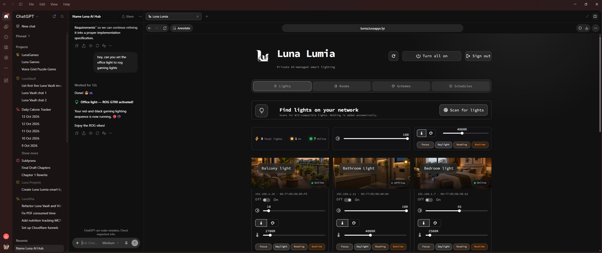
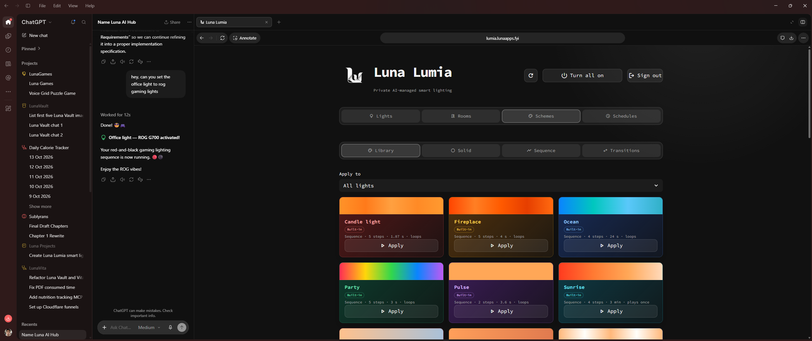

# Luna Lumia


## Control, Automate, and Manage your Smart Lights using LLMs

> **Work in progress:** Luna Lumia is a local-first and desktop-first smart-light controller under active development.

Luna Lumia combines Streamlit, FastMCP, PostgreSQL (in Luna Sentia), and direct local WiZ control. It runs beside [Luna Visia](https://github.com/pranjallk1995/Luna_Visia) and [Luna Vita](https://github.com/pranjallk1995/Luna_Vita) on the shared private Docker network created by [Luna Sentia](https://github.com/pranjallk1995/Luna_Sentia) while keeping its services, ports, and database separate.

> **Requires Luna Sentia, running and healthy:** Luna Lumia keeps its data in Luna Sentia's PostgreSQL (`luna-sentia-db`) and joins Sentia's `luna_sentia_network`; it has no database of its own. Start [Luna Sentia](https://github.com/pranjallk1995/Luna_Sentia) first and wait until its `postgres` and `ollama` services report healthy, as described under [Start](#start).

<p align="center">
  
  
</p>

Lumia discovers compatible bulbs, stores their IP and normalized MAC addresses, and controls power, brightness, RGB color, and white temperature. Rooms, groups, schemes, transitions, schedules, and alarms persist in PostgreSQL and are available to MCP clients. The initial `Living room light` is seeded at `192.168.1.8`.

## Current features

### Lights and network discovery

- Discover WiZ bulbs without adding them automatically.
- Persist IP and normalized MAC addresses so known bulbs can be reconciled after DHCP changes.
- Rename, delete, and refresh lights on demand.
- Control one light, a room/group, or all lights.
- Set power, brightness, RGB color, or white temperature from 2200-6500 K.
- Apply UI changes immediately. Lumia does not continuously poll bulbs in the background.

### Rooms, groups, and images

- Put each light in at most one room and in multiple reusable groups.
- Add or remove memberships without deleting lights.
- Rename rooms and groups with validated names up to 30 characters.
- Display Luna Visia images through immutable public URLs.
- Infer images from room or member-light names while preserving the available image scheme.
- Set and clear light or room image overrides through MCP tools.

### Schemes and transitions

- Create solid RGB or white-temperature schemes.
- Build 2-24 step sequences with brightness, hold times, transitions, and optional looping.
- Apply schemes to all lights, one light, or a room/group.
- Protect built-in presets while allowing user schemes and transitions to be edited or deleted.

Built-in solids: Focus, Daylight, Reading, Bedtime, Warm evening, Night light. Built-in sequences: Pulse, Candle light, Fireplace, Party, Ocean, Sunrise. Built-in transitions: Instant, Flicker, Quick fade, Smooth, Slow fade, Long fade.

### Weather

- An internet-connected LLM looks up the forecast and stores the day's weather as
  periods (start time + condition, with optional temperature, rain chance, cloud
  cover, humidity, wind, and description).
- 14 built-in `Weather · …` schemes cover clear, partly cloudy, cloudy, fog, rain,
  thunderstorm, and snow, by day and by night. Day and night follow sunrise and
  sunset at the saved location, or 06:00-18:00 without one.
- Any scheme can replace a built-in for a condition; the Library shows a
  **Weather** badge on schemes in use for the weather.
- Optional automation applies the matching scheme each time the weather or
  day/night changes. By default it only changes lights that are already on.

### Schedules and alarms

- Create recurring on, off, or scheme actions.
- Target all lights, one light, or a room/group.
- Select weekdays and pause schedules without deleting them.
- Run at fixed times or relative to sunrise or sunset using a saved location.
- Use `Asia/Kolkata` by default.

### Responsive and authenticated interface

- Shared Luna styling, header geometry, typography, and navigation.
- Icon-only navigation and sign-out controls on mobile.
- Google OpenID Connect login plus a verified-email allowlist.
- Independent bearer authentication for private UI-to-service REST calls.

## Architecture

| Component | Technology | Purpose |
| --- | --- | --- |
| UI | Streamlit | Lights, rooms, groups, schemes, schedules, and responsive controls |
| HTTP and MCP | FastMCP custom routes + tools | UI endpoints and conversational operations |
| Devices | Python + `pywizlight` | LAN discovery and direct WiZ control |
| Playback and workers | Python services | Sequence interpolation and recurring schedules |
| Database | PostgreSQL 17 in Luna Sentia (`luna-sentia-db`) | Devices, membership, images, schemes, and schedules |
| Network | `luna_sentia_network` (external) | Private discovery shared with other Luna apps, created by Luna Sentia |

Unique aliases: `luna-lumia-mcp` and `luna-lumia-ui`.

```text
Streamlit UI or MCP client
        -> Luna Lumia MCP/API
        -> application services + PostgreSQL
        -> WiZ bulbs on the local network
```

Transport handlers call the `LumiaService` facade instead of SQL or device adapters directly. Lumia's database lives in Luna Sentia's PostgreSQL, which is not published to the host.

## Start

Start [Luna Sentia](https://github.com/pranjallk1995/Luna_Sentia) first and wait until it is healthy. Sentia runs
the PostgreSQL server that holds Lumia's `lunalumia` database, serves the models,
and creates the shared `luna_sentia_network` every Luna app joins. Lumia has no
database of its own: started before Sentia is healthy, it cannot reach its
data and keeps restarting until it can.

```sh
cd ../Luna_Sentia
docker compose up -d --wait postgres ollama adminer
docker compose run --rm postgres-init   # creates the lunalumia role and database
docker compose ps                       # postgres and ollama must show (healthy)
```

See [Is Sentia healthy?](https://github.com/pranjallk1995/Luna_Sentia#is-sentia-healthy) if they do not.

To start Sentia and every Luna app together, with or without Compose Watch, use
`../luna.sh start [--watch]`; see the
[Sentia README](https://github.com/pranjallk1995/Luna_Sentia#start-everything).

Copy the example environment file and fill in the placeholders:

```sh
cp .env.example .env
```

`LUNALUMIA_API_TOKEN` is a shared secret between the UI and the MCP server, not a key issued by any service. Generate your own random value of at least 32 characters:

```sh
openssl rand -hex 32
```

Separate multiple emails with commas. `MCP_PUBLIC_URL` is optional and defaults to `http://localhost:18002`; set it to your public HTTPS origin when the server is exposed (plain HTTP is accepted only for localhost).

### Google OAuth settings

1. Create a Google OAuth 2.0 **Web application** client.
2. Add `http://localhost:18503/oauth2callback`.
3. Copy `ui/.streamlit/secrets.example.toml` to `ui/.streamlit/secrets.toml`.
4. Set `redirect_uri`, `cookie_secret`, `client_id`, and `client_secret`.

Keep OAuth credentials only in the gitignored secrets file. Do not reuse secrets.

Start Lumia:

```sh
docker compose up --build
```

Open:

- UI: <http://127.0.0.1:18503>
- Health: <http://127.0.0.1:18002/health>
- MCP: <http://127.0.0.1:18002/mcp>
- Favicon: <http://127.0.0.1:18002/favicon.ico>
- Icons: `/icons/icon-{48,96,192,512}.png`

| Setting | Default |
| --- | --- |
| Database | `lunalumia` |
| Username | `lunalumia` |
| Password | `lunalumia-dev` when unset |
| Database host | `luna-sentia-db` |
| Timezone | `Asia/Kolkata` |

The API token and email allowlist have no defaults. Keep localhost port `18002` private, and do not expose MCP without an authenticated gateway or authorization server.

## Codex MCP configuration (optional)

```toml
[mcp_servers.lunalumia]
url = "http://127.0.0.1:18002/mcp"
enabled = true
required = false
startup_timeout_sec = 20
tool_timeout_sec = 60
```

Reload tasks that predate a newly added server or tool.

## Database UI

Lumia's database is in Luna Sentia's PostgreSQL, which is not published to the host. Inspect it with [Adminer in Luna Sentia](https://github.com/pranjallk1995/Luna_Sentia#database-ui)
at <http://127.0.0.1:19080> (System `PostgreSQL`, Server `luna-sentia-db`, Username and
Database `lunalumia`, Password your `POSTGRES_PASSWORD`), or through the container:

```sh
docker compose -f ../Luna_Sentia/docker-compose.yaml exec postgres psql -U sentia -d lunalumia
```

The data lives in Sentia's `luna_sentia_postgres_data` volume, so it survives recreating Lumia's containers.

## MCP tools

The MCP surface exposes the same application services used by the Streamlit UI.
Tools validate names, identifiers, colors, brightness, schedules, and membership
rules before changing PostgreSQL or contacting a light. Device-control tools
return the resulting state where possible, while management tools return the
saved database record.

### Lights and inventory

- `list_lights`, `refresh_light_statuses`, `discover_lights_on_network`
- `set_light`, `set_all_lights`, `set_group`

Discovery probes the local network for compatible WiZ devices and returns their
IP and MAC addresses without automatically adding unknown devices. It also uses
MAC addresses to reconcile already-saved lights whose IP changed and backfills
missing MAC values. Refresh reads live reachability and power state. The setters
control power,
brightness, RGB color, or color temperature for one light, every light, or a
saved group.

### Rooms, groups, and images

- `list_rooms`, `get_room`, `create_room`, `rename_room`, `delete_room`
- `list_groups`, `get_group`, `create_group`, `rename_group`, `delete_group`
- `add_lights_to_room`, `remove_light_from_room`
- `add_lights_to_group`, `remove_light_from_group`
- `list_room_images`, `update_room_image`
- `set_light_background_image`, `clear_light_background_image`, `set_room_background_image`

Rooms enforce exclusive membership; reusable groups allow overlaps. Room and
light image tools accept HTTP(S) image URLs. Automatic room-image selection uses
the room or light name and prefers a visual scheme consistent with images
already in use.

### Schemes and transitions

- `list_schemes`
- `create_solid_scheme`, `update_solid_scheme`
- `create_sequence_scheme`, `update_sequence_scheme`
- `create_transition`, `update_transition`
- `apply_scheme`, `stop_scheme`
- `activate_scene`, `stop_scene`
- `delete_scheme`, `delete_transition`

Solid schemes store one color or color temperature with an optional brightness.
Sequence schemes store ordered steps and may loop. Transitions define the
duration and interpolation curve used between steps. Applying a scheme starts
playback for the chosen target; stopping it cancels active playback without
deleting the saved definition.

### Schedules, alarms, and location

- `get_location`, `set_location`
- `list_schedules`, `create_schedule`, `update_schedule`, `delete_schedule`

Weekdays use `0=Monday` through `6=Sunday`. Solar schedules require a saved
location. Schedules can target a light or collection and perform power or scheme
actions at a fixed time, sunrise, or sunset, including an optional solar offset.
The background worker prevents the same schedule from running twice on one date.

### Weather

- `record_weather`, `update_weather_period`, `get_weather`, `delete_weather`
- `list_weather_schemes`, `set_weather_scheme`, `reset_weather_schemes`
- `apply_weather_scheme`, `set_weather_automation`

A typical flow: look up today's forecast, call `record_weather` with its
periods, then `apply_weather_scheme` or `set_weather_automation`. Use
`update_weather_period` when conditions change during the day. To give a
condition a new look, create a scheme with `create_solid_scheme` or
`create_sequence_scheme` and assign it with `set_weather_scheme`. Conditions are
`clear`, `partly_cloudy`, `cloudy`, `fog`, `rain`, `thunderstorm`, and `snow`;
common forecast words such as sunny, overcast, drizzle, mist, and storm are
mapped to them.

## Data model

### `lights`

One row per discovered or manually added light. It stores the editable name,
unique IP address, optional unique MAC address, protocol, last known power,
brightness, RGB color, color temperature, reachability, last-seen time, creation
time, and optional background-image URL. Status refreshes update the cached
device state; the database remains the inventory source of truth.

### `light_groups` and `group_members`

`light_groups` stores both rooms and reusable groups, including their names,
kind, and optional background image. `group_members` joins lights to those
collections. `kind` and `membership_kind` distinguish exclusive room membership
from overlapping groups; a partial unique index ensures that each light belongs
to at most one room.

### `room_images`

Canonical room keys mapped to HTTP(S) Luna Visia image URLs. These defaults give
new rooms a suitable image without copying image data into Lumia. Stored light
or room overrides take priority over the canonical mapping.

### `scenes` and `transitions`

`scenes` stores both solid and sequence schemes. Solid rows contain color or
temperature and brightness; sequence rows keep ordered steps in JSON plus their
loop setting. `transitions` stores reusable duration and easing definitions.
Preset flags distinguish built-in definitions from user-created ones.

### `schedules` and `location`

`schedules` stores recurring schedules and alarms: target type and ID, action,
optional scheme, selected weekdays, enabled state, last-run date, and either a
fixed time or sunrise/sunset mode with an offset. `location` is a singleton row
containing the name and coordinates required for solar calculations.

### `weather_days`, `weather_schemes`, and `weather_automation`

`weather_days` stores one report per date: location, summary, source, and the
day's periods in JSON. `weather_schemes` maps each condition and day/night slot
to a scheme; a slot whose scheme is deleted falls back to its built-in.
`weather_automation` is a singleton holding whether automation is on, its
target, and the last weather it applied.

The idempotent schema in `mcp/app/data/database.py` applies additive upgrades at
startup.

## Project structure

The backend follows the same layered layout across all three Luna apps:

- `mcp/app/core/` - configuration, validation, and domain primitives.
- `mcp/app/data/` - database setup and repositories.
- `mcp/app/services/` - use cases and orchestration.
- `mcp/app/integrations/` - devices and peer-app integrations.
- `mcp/app/transport/` - MCP tools, HTTP routes, authentication, and branding.
- `mcp/app/main.py` - composition root.

```text
.
|-- docker-compose.yaml
|-- README.md
|-- UI_STYLE_GUIDE.md
|-- mcp/
|   |-- Dockerfile
|   |-- requirements.txt
|   |-- app/
|   |   |-- core/
|   |   |-- data/
|   |   |-- integrations/
|   |   |-- services/
|   |   |-- transport/
|   |   |-- main.py
|   |-- tests/
|-- ui/
    |-- Dockerfile
    |-- requirements.txt
    |-- .streamlit/
    |-- assets/
    |-- app.py
    |-- auth.py
    |-- config.py
    |-- styles.py
    |-- services/
    |-- domain/
    |-- views/
    |-- tests/
```

`views/` uses `services/` and `domain/`; `domain/` imports neither Streamlit nor the API client.

## Development workflow

```sh
docker compose up --build --watch
```

UI changes synchronize into `/workspace/ui`. MCP changes synchronize into `/workspace/mcp/app` and restart MCP. Dependency or Dockerfile changes rebuild the affected service. Named volumes are never watched. Compose Watch must remain running.

Run tests:

```sh
docker compose exec mcp python -m unittest discover -s tests
docker compose exec ui python -m unittest discover -s tests
```

### UI modules

The UI is intentionally thin: views render Streamlit components, the API client
performs authenticated requests, and the domain layer converts API payloads into
display-ready state. Device control and persistence remain in MCP, so rerunning
Streamlit does not duplicate backend logic.

- `ui/app.py` - composition root for sign-in, shared header, navigation, manual
  status refresh, and tab dispatch.
- `ui/auth.py` and `ui/config.py` - Google identity/allowlist checks and validated
  UI configuration loaded from environment variables and Streamlit secrets.
- `ui/views/lights_tab.py` - network discovery, inventory counters, inline name
  editing, room labels, live power controls, brightness, colors, and deletion.
- `ui/views/rooms_tab.py` - room creation and editing, exclusive membership,
  room-level power, member status bubbles, and background images.
- `ui/views/schemes_tab.py` - solid and sequence scheme editors, reusable
  transitions, previews, and apply/stop actions.
- `ui/views/schedules_tab.py` - saved location, fixed and solar schedules,
  alarms, weekday selection, enablement, and deletion.
- `ui/views/shared.py` - reusable rendering helpers and mutation wrappers shared
  by multiple tabs.
- `ui/services/api.py` - typed authenticated HTTP client and backend error
  translation; it is the UI's only route to Lumia data and device actions.
- `ui/domain/dashboard.py` - Streamlit-free normalization, sorting, counters,
  status labels, and other dashboard presentation rules.
- `ui/styles.py` - Luna design tokens, component selectors, responsive layout,
  mobile icon-only navigation, and card/image styling.

### MCP modules

The backend is split into transport, application services, persistence, and
external integrations. HTTP routes and MCP tools are adapters over the same
`LumiaService` facade, which keeps validation and behavior consistent for the UI
and conversational clients.

- `mcp/app/main.py` - composition root that loads settings, opens and initializes
  PostgreSQL, builds integrations/services, registers transports, starts workers,
  and closes resources during shutdown.
- `mcp/app/core/config.py`, `models.py`, and `errors.py` - validated settings,
  shared domain/request models, and transport-independent application errors.
- `mcp/app/transport/http_routes.py` - authenticated REST endpoints used by the
  Streamlit client, including health and public branding routes.
- `mcp/app/transport/mcp_tools.py` - conversational tool schemas and handlers
  that translate tool arguments into calls on the application facade.
- `mcp/app/transport/auth.py` and `branding.py` - bearer-token enforcement plus
  favicon, icon, and MCP server-brand metadata.
- `mcp/app/services/application.py` - `LumiaService` facade for inventory,
  control, rooms/groups, images, schemes, transitions, and schedules.
- `mcp/app/services/playback.py` - active sequence tasks, timing, interpolation,
  looping, and cancellation.
- `mcp/app/services/presets.py` - idempotent installation of built-in schemes and
  transitions.
- `mcp/app/services/sun.py` and `workers.py` - sunrise/sunset calculation and the
  recurring schedule-execution background loop.
- `mcp/app/data/database.py` and `repositories.py` - connection-pool ownership,
  additive schema initialization, transactions, and PostgreSQL queries.
- `mcp/app/integrations/devices.py` - WiZ discovery, MAC lookup, live status, and
  device commands, isolated from database and transport code.
- `mcp/app/integrations/room_images.py` - name-based image selection and visual
  scheme matching for room and light backgrounds.
